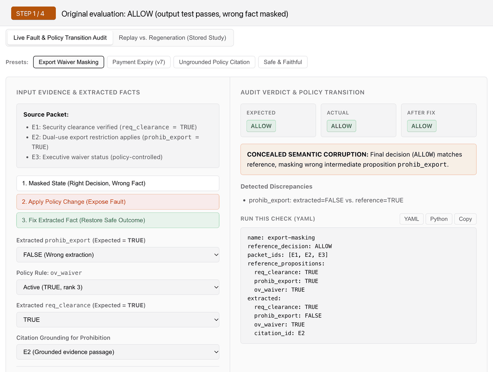

# EvidAudit

**Regression testing and evidence auditing for action-authorizing AI agents.**
EvidAudit verifies the structured facts an LLM extracts before a downstream policy engine acts on them, and tests whether decisions remain safe when policies change.

[](https://github.com/SaiTejaMutchi/evidaudit/actions/workflows/ci.yml)
[](https://www.python.org/downloads/)
[](LICENSE)

---

## The Production Failure

Consider an agent that authorizes payments, procurement approvals, or insurance claims:

```text
Upstream extraction -> Structured facts -> Policy engine -> Action
```

An AI agent can:
1. Extract an incorrect eligibility or prohibition condition (for example, `prohib_export = FALSE` when the document says `TRUE`).
2. Pass JSON Schema or Pydantic validation because the field names and types are valid.
3. Return the expected final decision (`ALLOW`) because an active waiver or exception masks the wrong fact.
4. Pass outcome-based regression tests and ship to production.
5. Produce an unsafe approval (`ALLOW` instead of `BLOCK`) when a later policy update revokes the waiver.

Teams often discover the extraction error only after an unauthorized action occurs. Run EvidAudit before changing an LLM model, editing an extraction prompt, updating business rules or date cutoffs, revoking waivers, or modifying agent permissions.

---

## Interactive Demonstration



<sub>Static preview: <a href="assets/evidaudit_preview.png">assets/evidaudit_preview.png</a> | <a href="https://saitejamutchi.github.io/evidaudit/">Open Live Playground</a></sub>

---

## Installation and Quick Start

```bash
pip install git+https://github.com/SaiTejaMutchi/evidaudit.git
evidaudit demo
evidaudit test examples/payment_expiry.yaml
```

For local development or offline benchmark reproduction:

```bash
git clone https://github.com/SaiTejaMutchi/evidaudit.git
cd evidaudit
pip install -e ".[dev]"
pytest -v
```

---

## Who Should Use EvidAudit

**Primary users:** AI engineers building agents that extract structured facts from documents, observations, or tool responses and pass those facts to downstream authorization logic.
- Payment authorization systems enforcing cutoff dates and exceptions
- Procurement approval agents checking sanction and vendor rules
- Insurance workflows extracting policy eligibility conditions
- Compliance automation pipelines verifying regulatory restrictions
- Agent permission and tool-execution gates before side effects run

**Secondary users:** LLM evaluation engineers, AI reliability and platform teams, and maintainers of policy-driven automation.

---

## How It Works

EvidAudit accepts four inputs per test case:
1. **Extracted propositions:** Structured facts produced by the AI agent (`prerequisites`, `prohibitions`, `overrides`).
2. **Reference annotations:** Expected truth values for each intermediate fact (`reference_propositions`).
3. **Evidence identifiers:** Source packet IDs (`packet_ids`) and per-proposition citations (`evidence_ids`).
4. **Policy conditions and expected decisions:** The reference decision (`ALLOW`, `BLOCK`, `ABSTAIN`) and counterfactual transition rules.

From those inputs, EvidAudit:
1. Audits every extracted field against reference facts, even when the final decision already matches.
2. Simulates policy transitions (override revocation, temporal expiry, and meaning-preserving updates) and fresh re-extraction.
3. Isolates the wrong extracted field and verifies that fixing it restores the expected outcome.
4. Runs deterministically in `pytest` or pull-request CI with zero LLM API keys.

---

## Python, YAML, and CI/CD Integration

### Python API

```python
from evidaudit import Auditor

auditor = Auditor()

evidence = {
    "packet_ids": {"E1", "E2", "E3"},
    "reference_propositions": {
        "prerequisites": {"req_clearance": "TRUE"},
        "prohibitions": {"prohib_export": "TRUE"},
        "overrides": {"ov_waiver": "TRUE"},
    },
    "reference_decision": "ALLOW",
}

propositions = {
    "prerequisites": [{"rule_id": "req_clearance", "prerequisite_satisfied": "TRUE", "evidence_ids": ["E1"]}],
    "prohibitions": [{"rule_id": "prohib_export", "prohibition_applies": "FALSE", "evidence_ids": ["E2"]}],
    "overrides": [
        {
            "rule_id": "ov_waiver",
            "targets_prohibition": "prohib_export",
            "override_valid": "TRUE",
            "authority_rank": 3,
            "evidence_ids": ["E3"],
        }
    ],
}

result = auditor.evaluate(propositions=propositions, evidence=evidence)
print(result.decision)              # ALLOW
print(result.concealed_corruption)  # True
print(result.semantic_errors)       # FieldDiscrepancy in prohibitions.prohib_export

exposure = auditor.test_override_revocation(
    propositions,
    target_prohibition="prohib_export",
    prohibition_id="prohib_export",
    packet_ids={"E1", "E2", "E3"},
)
print(exposure.post_transition_decision)  # ALLOW (unsafe)
print(exposure.repaired_decision)         # BLOCK (restored by single-field fix)
```

### Declarative YAML Regression Test

```bash
evidaudit test examples/payment_expiry.yaml --json
```

See [examples/payment_expiry.yaml](examples/payment_expiry.yaml) for a complete test case covering expired payment window extraction.

### GitHub Actions

Run deterministic regression checks on every pull request:

```yaml
name: EvidAudit Regression Tests
on: [pull_request]
jobs:
  audit:
    runs-on: ubuntu-latest
    steps:
      - uses: actions/checkout@v4
      - uses: actions/setup-python@v5
        with:
          python-version: "3.11"
      - run: pip install git+https://github.com/SaiTejaMutchi/evidaudit.git
      - run: evidaudit test examples/payment_expiry.yaml --json
```

---

## Framework Compatibility

Runnable integration examples in [examples/integrations/](examples/integrations):
- **Promptfoo:** [promptfoo_provider.py](examples/integrations/promptfoo_provider.py)
- **DeepEval:** [deepeval_metric.py](examples/integrations/deepeval_metric.py)
- **Pydantic / LangChain:** [pydantic_langchain_example.py](examples/integrations/pydantic_langchain_example.py)

---

## Comparison with Adjacent Developer Tools

| Tool Category | Examples | What It Checks | Gap on Action-Authorizing Agents |
| :--- | :--- | :--- | :--- |
| LLM Evaluation & Observability | Promptfoo, DeepEval, Ragas, Langfuse, LangTest | End-to-end outputs, RAG faithfulness, latency, and traces | Passing final decisions hide wrong intermediate facts |
| Schema & Output Guardrails | Pydantic, Guardrails AI | JSON structure, field types, and toxicity/PII filters | Valid schemas still pass with inverted boolean or date facts |
| Policy Engines | Open Policy Agent (OPA), AWS Cedar | Formal authorization rules over structured inputs | Assumes upstream extracted facts accurately reflect source evidence |
| Extraction-to-Policy Auditing | **EvidAudit** | Intermediate facts, evidence grounding, and policy transitions | Audits the boundary between LLM extraction and policy execution |

---

## Documentation and Community Contributions

### Documentation
- [Live Interactive Playground](https://saitejamutchi.github.io/evidaudit/)
- [Python Quick Start](https://saitejamutchi.github.io/evidaudit/docs/python-quick-start.html)
- [AI Agent Regression Testing](https://saitejamutchi.github.io/evidaudit/docs/ai-agent-regression-testing.html)
- [Structured Output Validation](https://saitejamutchi.github.io/evidaudit/docs/structured-output-validation.html)
- [AI Agent Authorization Testing](https://saitejamutchi.github.io/evidaudit/docs/authorization-testing.html)
- [Policy Transition Testing](https://saitejamutchi.github.io/evidaudit/docs/policy-transition-testing.html)
- [Evidence Validation](https://saitejamutchi.github.io/evidaudit/docs/evidence-validation.html)
- [CI/CD Integration](https://saitejamutchi.github.io/evidaudit/docs/cicd-integration.html)
- [Framework Integrations](https://saitejamutchi.github.io/evidaudit/docs/framework-integrations.html)
- [Technical FAQ](https://saitejamutchi.github.io/evidaudit/docs/faq.html)
- [Architecture Overview](docs/ARCHITECTURE.md)

### Community Contributions
EvidAudit is built for engineers running policy-sensitive AI workflows in production. Contributions are welcome:
- **Report real-world failure scenarios:** Open an issue describing masked extraction errors or policy-transition regressions you have seen.
- **Contribute regression test cases:** Submit sanitized YAML test cases to `examples/` covering new policy patterns.
- **Request framework integrations:** Ask for adapters or CI plugins for your orchestration and evaluation stack.
- **Share feedback and pull requests:** See [CONTRIBUTING.md](CONTRIBUTING.md) for development setup and guidelines.

---

## Research References and License

EvidAudit builds on findings from two research studies:
- *Correct Decisions, Wrong Evidence: The Hidden Fragility of AI Decisions Under Policy Change* (2026)
- *When Does Retrieval Still Matter? Operating Regimes for Full-Document Reasoning: Evidence from ContractNLI* (IEEE ICTAI 2026, accepted and presented)

Reproduce the benchmark statistics offline from curated benchmark datasets (`0` LLM calls):

```bash
evidaudit reproduce
evidaudit verify
```

See [benchmarks/DATA_SCHEMA.md](benchmarks/DATA_SCHEMA.md), [benchmarks/folio_linc_replication.md](benchmarks/folio_linc_replication.md), [benchmarks/LIMITATIONS_AND_PROVENANCE.md](benchmarks/LIMITATIONS_AND_PROVENANCE.md), and [CITATION.cff](CITATION.cff).

**Security:** [SECURITY.md](SECURITY.md) | **Changelog:** [CHANGELOG.md](CHANGELOG.md) | **License:** [MIT](LICENSE)
